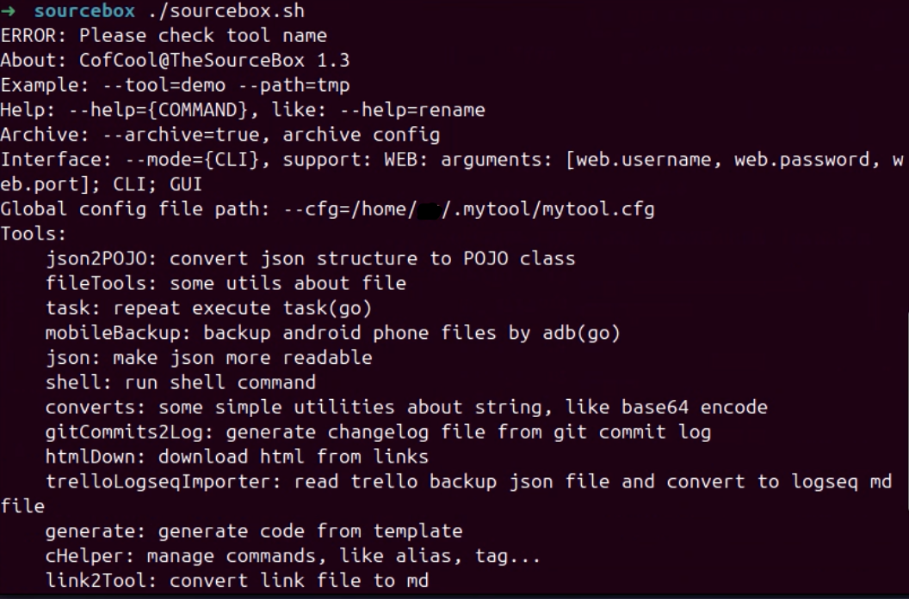
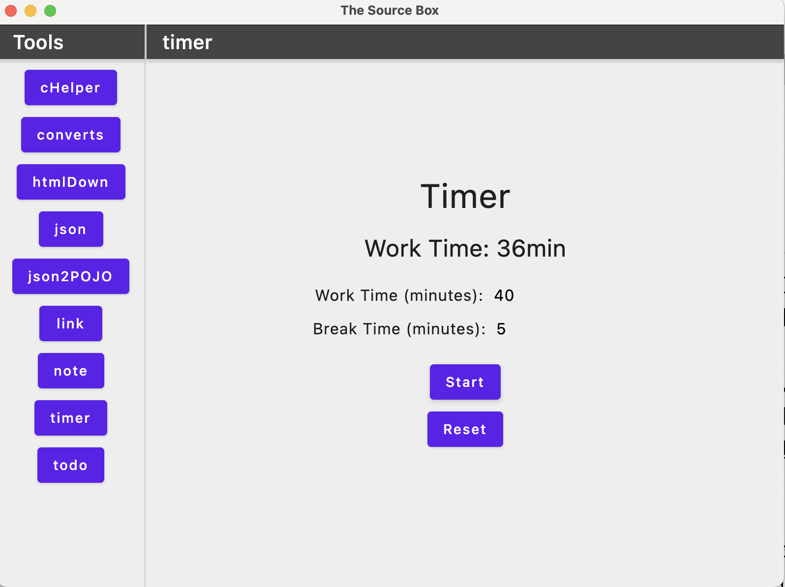
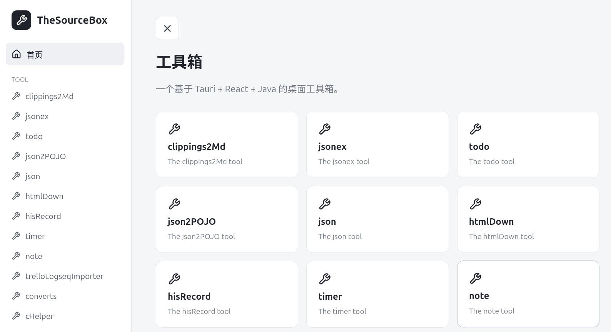
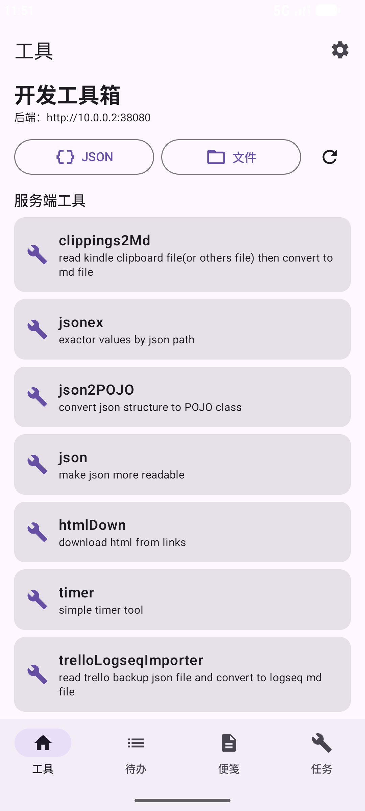
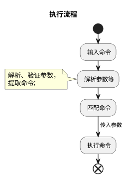

<div align="center">
  <h1>秘源宝箱</h1>
  <p><strong>包含众多小工具的宝箱，借用秘源之力解放自我  🎉🎉🎉</strong></p>
  <p>
    
    <a href="https://github.com/cofcool/sourcebox/releases/latest"></a>
    <a href="LICENSE"></a>
  </p>
</div>

---

使用 Java（JDK 25 起）、Python、Go 等语言实现，桌面版使用 KMP 框架，Android 使用 Kotlin，各个客户端通过调用后台服务来实现功能，基于 Vert.x，默认端口为 38080

命令参数也可通过全局配置文件进行配置，路径为 `~/.mytool/mytool.cfg`

* `./sourcebox.sh` 查看程序信息，`--help={COMMAND}` 查看具体命令的帮助信息, 如 `--help=converts`
* `--debug=true` 打开调试模式
* `--completion=zsh` 生成命令补全脚本，在 `~/.zshrc` 中加入
    ```
     fpath=(~/.zsh/completions $fpath)
     autoload -Uz compinit
     compinit
     ```

部分命令支持别名， 如 `--tool=converts --cmd=md5 --in=test` 的别名为 `--md5=test`，具体可查看帮助文档，也可借助命令助手配置别名

项目构建:

* 安装 JDK 25、Maven、Node.js 和 npm 后运行 `mvn package` 构建项目
* 启动后台服务后，可通过 `http://localhost:38080/web/` 访问 Web 前端

---

软件截图

命令模式:



图形界面模式:



WEB:



Android:



---

## 命令助手

使用前需要把 `source $HOME/.mytool/alias` 添加到 shell 配置中

* 命令管理，方便管理日常使用的长命令，如查询，添加标签等
* 别名管理，可针对长命令配置别名，并导出到当前环境
* 历史记录管理，导入、管理 zsh、bash 的命令历史记录 

使用:

* 添加 `./sourcebox.sh --tool=cHelper --add="@helper sourcebox --tool=cHelper #sourcebox #my"`，`@`开头的为别名，可选参数；`#`开头的为标签，可以为多个，可选参数
* 导出到环境变量 `./sourcebox.sh --tool=cHelper --store=ALL` ，`--store` 参数可指定需要导出的命令，支持别名和标签，如 `--store="#kafka"`，只会导出有别名的命令
* 查询 `./sourcebox.sh --tool=cHelper --find=ALL` 查询命令，支持别名和标签，可以多个，如 `--find="#my @helper"`
* 删除 `./sourcebox.sh --tool=cHelper --del=ALL` 删除命令，支持别名和标签，可以多个，如 `--del="#my @helper"`

内置别名：

```
@helper sourcebox --tool=cHelper #sourcebox
@mlower sourcebox --tool=converts --cmd=lower #sourcebox
@mupper sourcebox --tool=converts --cmd=upper #sourcebox
@mmd5 sourcebox --tool=converts --cmd=md5 #sourcebox
@mtimesp sourcebox --tool=converts --cmd=timesp #sourcebox
@mnow sourcebox --tool=converts --cmd=now #sourcebox
@mhdate sourcebox --tool=converts --cmd=hdate #sourcebox
```

注意：执行无参命令时会自动导入 shell 的历史记录，并进入 REPL 环境，输入命令时自动根据历史记录进行补全，确定后会输出到标准输出流中，**如想实现命令确认后立即执行**，使用： `eval $(helper)` 

## 常用字符串转换工具

使用: `./sourcebox.sh --tool=converts --cmd="now" --pipeline="md5 | base64"`

支持功能（可通过 `|` 连接多个命令）:

* md5，生成指定字符串的 md5 值
* kindle，Kindle 笔记内容转换为 Markdown 文档
* upper/lower，字符串大小写转换
* hdate，时间戳转换为易于阅读的时间格式
* timesp，把时间转换为时间戳
* now，当前时间戳
* replace，字符串替换
* base64，编码和解码
* morsecode，摩尔斯电码转换
* security，加密/解密
* dataunit，字节显示更易读
* ...

## 网页下载

* 链接递归遍历
* 代理
* 批量下载
* 转换为 markdown、text、epub

使用: `./sourcebox.sh --tool=htmlDown --url="https://example.com"`

## Git 提交记录生成更新日志

使用: `./sourcebox.sh --tool=gitCommits2Log --path=./`

## 简单 Web 文件服务器

使用 `./sourcebox.sh --tool=dirWebServer`, `WEB` 模式下配置全局变量 `web.fileshare` 后可通过 `/fileshare/` URL 路径进行文件共享

## 局域网点对点文件分享

`lanShare` 可在局域网设备间双向发送文件或目录。先在接收设备启动接收端：

```bash
./sourcebox.sh --tool=lanShare --mode=receive --dir=./received
```

接收端会显示局域网访问地址和令牌。默认 `--port=0`，由操作系统自动分配可用端口；也可通过 `--port=43127` 指定端口。此服务独立于现有 Web 服务，不使用其默认端口 `38080`。保持接收进程运行，在发送设备执行：

```bash
./sourcebox.sh --tool=lanShare --mode=send --to=http://192.168.1.20:43127 --token=接收端显示的令牌 --path=./photos
```

`--path` 可以是文件或目录。未压缩时逐项传输，目录结构和顶层名称会保留；默认 `--compress=false`。需要先压缩为 ZIP 再传输时，发送端加 `--compress=true`：

```bash
./sourcebox.sh --tool=lanShare --mode=send --to=http://192.168.1.20:43127 --token=接收端显示的令牌 --path=./photos --compress=true
```

发送端会为每个未压缩文件或压缩后的 ZIP 计算 SHA-256，接收端校验通过后才保存；校验失败时会报告期望值和实际值并拒绝该数据。

文件冲突策略由接收端设置，默认为跳过并在发送端打印冲突路径；可在接收端用 `--conflict=overwrite` 覆盖已存在文件：

```bash
./sourcebox.sh --tool=lanShare --mode=receive --dir=./received --conflict=overwrite
```

接收完成后可按 `Ctrl+C` 关闭接收端。传输使用 HTTP，请只在可信任的局域网中使用。

## JSON 生成对象

使用: `./sourcebox.sh --tool=json2POJO --path=./`

支持:

* Java class/record

## Trello 导出的 JSON 文件导入到 Logseq

支持把从 Trello 看板导出的 JSON 文件导入到 Logseq

##  文件重命名

使用: `./sourcebox.sh --tool=rename --path=./`

支持:

* order, 文件序号
* date, 日期
* datetime, 时间
* urlencoded, 解码 URL 编码
* replace, 字符串替换
* move, 移动文件
* replace, 移除字符

## Git diff 分析

* 根据 diff 信息抽取对应行的变更记录

使用: `git diff --unified=0 --diff-filter=M . | ./sourcebox.sh --tool=analysisDiff --path=./ > diff.csv`

## 文件处理工具

* 统计一个文件内容在另一个文件中的数量，使用: `./sourcebox.sh --tool=fileTools --util=count --samplePath=sample.csv --path=data.csv`
* 根据传入的字符或索引切割文件内容，使用: `./sourcebox.sh --tool=fileTools --util=split --path=data.csv --splitIdx=2`
* 查找重复文件，使用: `./sourcebox.sh --tool=fileTools --util=dup --path=./`
* 遍历文件并对其执行自定义命令，使用 `./sourcebox.sh --tool=fileTools --util=foreach  --path=./ --foreachDo='file $file'`

## 网络工具

* IP 信息查询，`./sourcebox.sh --tool=netUtils --util=ip --in=127.0.0.1`
* DNS 查询，`./sourcebox.sh --tool=netUtils --util=dns --in=github.com`

## 阅读软件笔记、高亮导出为 markdown 文件

支持 Kindle、Moon+ Reader

## LinkCovertTool

Java，可把后缀为`.desktop`，`.webloc`的多个网页快捷文件提取到链接并输出到Markdown文件。

## 简单笔记

简单笔记软件，开发目的是为局域网内部的多台设备进行信息同步，基于 Vert.x Web 开发，内容以 JSON 格式存储到文件中

配置:

* filepath，文件保存路径，默认为当前目录
* filename，文件名称，默认为 `note.json`
* port，监听端口，默认为 `38080`

## JSON 格式化

使用: `./sourcebox.sh --tool=json [--json='{}'] [--path=dmeo.json]`，支持 JSON Line

## 重复执行 SHELL 命令

支持指定执行次数，循环次数，执行频率等，使用: `./sourcebox.sh --tool=task --count=10 --cmd='echo $count'`

## 简单 ToDo

简单的 ToDo 工具，支持创建、完成、搜索，使用: `./sourcebox.sh --tool=todo --add=`

如果输入名称是网址，会自动识别网页标题

## 简单番茄时钟

工作和休息计时，休息时弹出全屏遮罩提示进入休息时间

## JSON 内容提取

通过 JSON path 规则提取内容

## 参与开发

执行流程：



## 致谢

